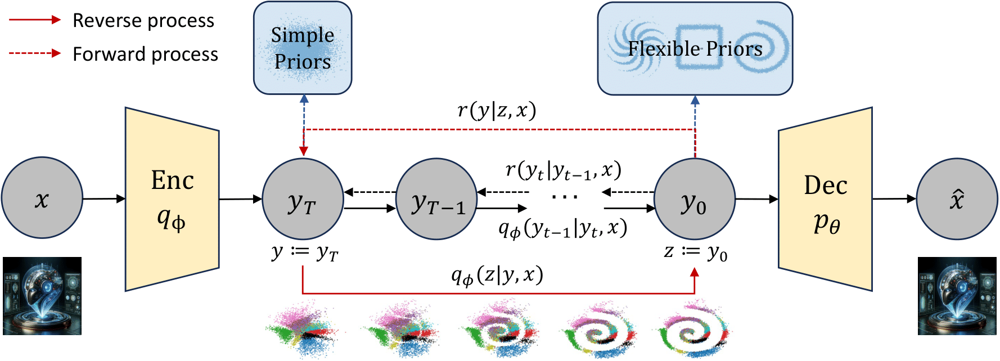

# [Denoising Diffusion Variational Inference: Diffusion Models as Expressive Variational Posteriors](https://arxiv.org/abs/2401.02739)
By [Yingheng Wang](https://yingheng-wang.com/)\*, [Wasu Top Piriyakulkij](https://www.cs.cornell.edu/~wp237/)\*, [Volodymyr Kuleshov](https://www.cs.cornell.edu/~kuleshov/) (\*equal contribution)

[](https://arxiv.org/abs/2401.02739)
[](https://yingheng-wang.com/DDVI/)
[](https://github.com/yingheng-wang/DDVI/actions/workflows/tests.yml)



Variational inference in latent variable models with structured priors needs posteriors that can match those priors. We introduce ***DDVI*** (**D**enoising **D**iffusion **V**ariational **I**nference), which uses a diffusion model as the variational posterior: an encoder gives q(y_T | x), a reverse diffusion process q(z | y_T, x) iteratively refines y_T into the latent z, and the forward process r(y | z) serves as the auxiliary reverse model of an auxiliary-variable ELBO. Training alternates wake steps on (a surrogate of) this ELBO with sleep steps that fit the reverse process on samples from the prior and the decoder, as in the wake-sleep algorithm. On MNIST and CIFAR-10 with pinwheel, Swiss roll and square priors, DDVI has the lowest Latent NLL in all twelve unsupervised and semi-supervised settings and a higher ELBO than the flow-based AEVB-IAF in eleven of them.

In this repo, we provide:
* **The DDVI framework**
  1. **DDVI** with an x-conditional reverse process trained by wake-sleep (`model=ddvi`), initialized from the simplified DDVI with an x-independent reverse process (`model=ddvi_simplified`).
  2. **Semi-supervised DDVI** with one prior denoiser per partition of the prior (`model=ddvi_semi`).
* **Baselines**: AEVB, AEVB-IAF, H-AEVB, PIS (our reimplementation) and AAEB, and the semi-supervised AEVB, AEVB-IAF and AAEB.
* **Evaluation**: the ELBO of every method, including the change-of-variables density of DDVI's deterministic DDIM posterior; KNN accuracy, Latent NLL and MMD; aggregation over seeds.
* **Structured priors**: pinwheel, Swiss roll and square, each with ten partitions for semi-supervised learning.

## Main Results

Unsupervised MNIST (Table 1 of the paper): ELBO (↑, nats per image) and Latent NLL (↓), mean over three seeds.

| Method | Pinwheel ELBO | Pinwheel NLL | Swiss roll ELBO | Swiss roll NLL | Square ELBO | Square NLL |
|---|---:|---:|---:|---:|---:|---:|
| AEVB | −169.9 | 1.55 | −174.6 | 5.63 | −172.4 | 2.93 |
| AEVB-IAF | −159.7 | 1.29 | −170.7 | 3.70 | −160.2 | 1.72 |
| AAEB | – | 1.54 | – | 3.34 | – | 2.27 |
| H-AEVB | −154.6 | 1.54 | −158.2 | 2.92 | −155.8 | 1.67 |
| PIS (reimpl.) | −192.6 | 2.13 | −216.6 | 6.19 | −204.6 | 3.68 |
| DDVI | **−151.5** | **1.11** | **−155.9** | **2.27** | **−146.6** | **1.56** |

The ELBO follows the evaluation conventions of the paper (Section 5.1); see [docs/REPRODUCING.md](docs/REPRODUCING.md#evaluation). All entries of Tables 1, 2, 7, 8 and 9, with 95% confidence intervals, are in [`results/paper_tables.json`](results/paper_tables.json).

<a name="code-organization"></a>
## Code Organization
1. ```train.py```: trains one model from its Hydra config and writes its test-set metrics
2. ```evaluate_elbo.py```: ELBO of trained runs
3. ```aggregate.py```: tables over seeds (mean ± 95% confidence interval)
4. ```ddvi/models/```: DDVI (```ddvi.py```), simplified and semi-supervised DDVI (```ddvi_simplified.py```), and the baselines (```vae.py```, ```pis.py```, ```aae.py```)
5. ```ddvi/```: data loaders, structured priors and their density estimates, networks, IAF layers, prior diffusion, metrics
6. ```conf/```: Hydra configs for datasets, priors and models; the model configs hold the paper's hyperparameters
7. ```scripts/```: one script per table of the paper
8. ```results/```: the numbers reported in the paper's tables
9. ```tests/```: CPU checks of every model
10. ```docs/```: the [reproduction guide](docs/REPRODUCING.md)

<a name="getting_started"></a>
## Getting Started

Create an environment with the tested dependencies (Python 3.9, PyTorch 1.12.1, CUDA 11.3) and run the CPU checks:

```bash
conda create --name ddvi python=3.9
conda activate ddvi
pip install -r requirements.txt
python -m unittest discover -s tests
```

MNIST and CIFAR-10 are downloaded by torchvision into `data/` on first use (`data_dir=...` to change it).

Train DDVI on MNIST with the pinwheel prior, in two stages, and compute its ELBO:

```bash
python train.py dataset=mnist model=ddvi_simplified prior=pinwheel seed=0   # stage 1
python train.py dataset=mnist model=ddvi prior=pinwheel seed=0              # stage 2, initialized from stage 1
python evaluate_elbo.py runs/mnist/ddvi/pinwheel/seed0
```

Each run writes its config, log, checkpoint, metrics and latents to `runs/<dataset>/<model>/<prior>/seed<seed>/`. Options are Hydra overrides, e.g. `model.kld_weight=0.5` or `run_root=/scratch/runs`. Datasets: `mnist`, `mnist_semi`, `cifar10`, `cifar10_semi`; priors: `pinwheel`, `swiss_roll`, `square`.

| `model=` | Method |
|---|---|
| `ddvi` | DDVI (unsupervised) |
| `ddvi_simplified` | simplified DDVI; first training stage of `ddvi` |
| `ddvi_semi` | DDVI (semi-supervised) |
| `aevb`, `aevb_semi` | AEVB |
| `aevb_iaf`, `aevb_iaf_semi` | AEVB-IAF |
| `h_aevb` | H-AEVB |
| `pis` | PIS (our reimplementation) |
| `aaeb`, `aaeb_semi` | AAEB |

## Reproducing Experiments

Each table of the paper has a script that trains every method, prior and seed, evaluates the ELBO and prints the table:

```bash
bash scripts/table1_mnist.sh          # Table 1: unsupervised MNIST
bash scripts/table2_mnist_semi.sh     # Table 2: semi-supervised MNIST, 1,000 labels
bash scripts/table7_cifar10.sh        # Table 7: unsupervised CIFAR-10
bash scripts/table8_cifar10_semi.sh   # Table 8: semi-supervised CIFAR-10, 10,000 labels
bash scripts/table9_sleep_ablation.sh # Table 9: DDVI without the sleep step
```

The jobs are independent and run one after another; set `LAUNCH` to a command prefix (e.g. `LAUNCH="srun --gres=gpu:1"`) to dispatch each one to a scheduler. The [reproduction guide](docs/REPRODUCING.md) gives the per-table settings, run times, output files and the evaluation protocol.

## Acknowledgements
The MADE and IAF layers adapt [pytorch-made](https://github.com/karpathy/pytorch-made) and [iaf-vae](https://github.com/pclucas14/iaf-vae), the kernel density estimate follows [pytorch-generative](https://github.com/EugenHotaj/pytorch-generative), and the AAE baseline follows [AAE_pytorch](https://github.com/fducau/AAE_pytorch). See [THIRD_PARTY_NOTICES.md](THIRD_PARTY_NOTICES.md).

## Citation
```bibtex
@inproceedings{piriyakulkij-wang:aaai25,
  title     = {Denoising Diffusion Variational Inference: Diffusion Models as Expressive Variational Posteriors},
  author    = {Piriyakulkij, Wasu Top and Wang, Yingheng and Kuleshov, Volodymyr},
  booktitle = {Proceedings of the AAAI Conference on Artificial Intelligence},
  year      = {2025}
}
```

## License
New code is released under the MIT License. `ddvi/models/aae.py`, which follows AAE_pytorch, is distributed under GPL-3.0; see [LICENSE](LICENSE), [licenses/GPL-3.0.txt](licenses/GPL-3.0.txt) and [THIRD_PARTY_NOTICES.md](THIRD_PARTY_NOTICES.md). MNIST and CIFAR-10 are not covered and must be obtained under their own terms.
